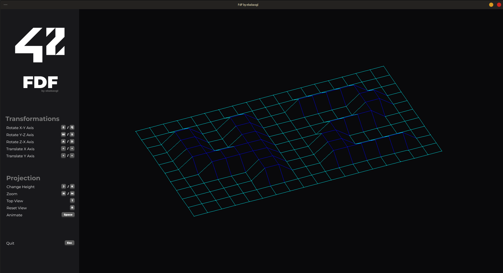

## installation & usage

reqs for debian/ubuntu: `xorg` `libxext-dev` `zlib1g-dev`

```bash
git clone --recursive https://github.com/lareii/fdf.git
cd fdf
make
./fdf <map_file>

# for bonus features:
# make bonus
# ./fdf_bonus <cub_file>
```

## preview


[demo video](https://www.youtube.com/watch?v=_YHez1YKnVc)

### references
- https://en.wikipedia.org/wiki/Rotation_matrix
- https://en.wikipedia.org/wiki/Digital_differential_analyzer_(graphics_algorithm)
- https://harm-smits.github.io/42docs/libs/minilibx
